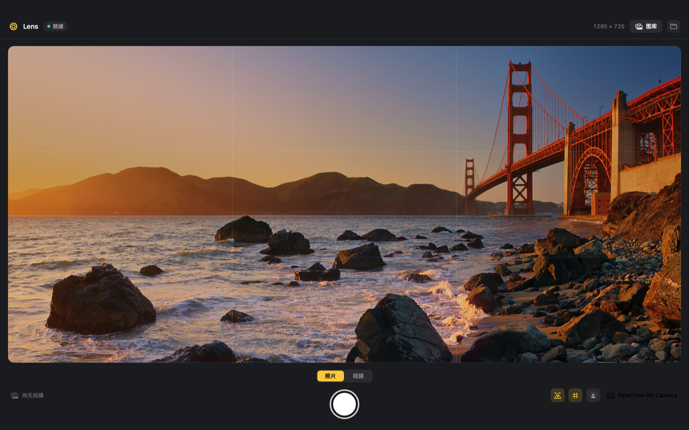
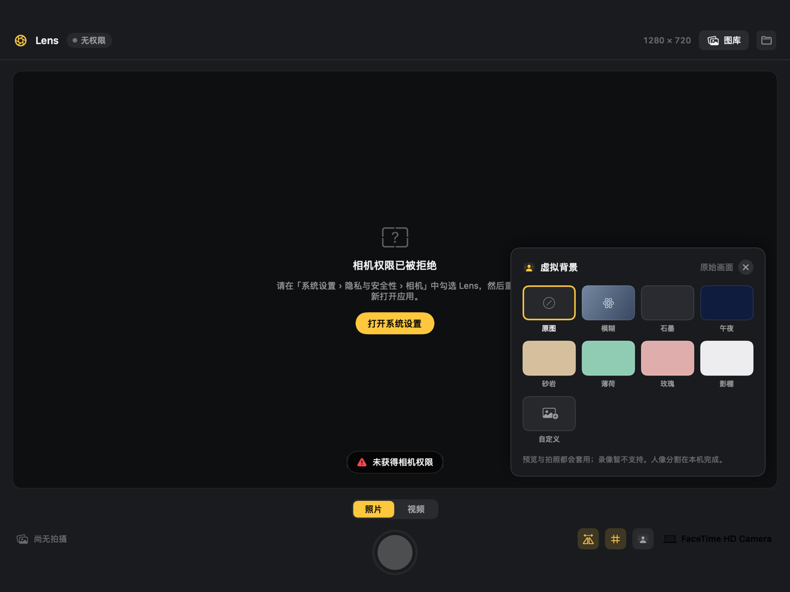
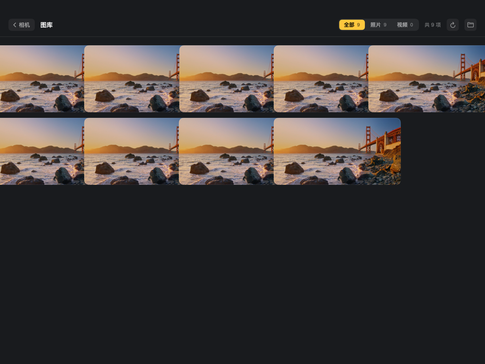

# Lens

一款 macOS 原生相机应用。SwiftUI + AVFoundation 构建，支持实时人像分割的虚拟背景。



## 功能

**拍摄**
- 实时取景，三分网格与镜像预览
- 拍照（空格键）、录像（含麦克风收音）
- 多摄像头切换：内置 / 外接 / iPhone 连续互通 / 桌面视角，支持热插拔自动切换

**虚拟背景**
- 人像分割用 Vision 在本机完成，画面不出设备
- 模糊背景、6 种纯色、自定义图片
- 预览与拍照同时生效

**图库**
- 扫描 `~/Pictures/Lens` 与 `~/Movies/Lens`
- 自适应网格，按全部 / 照片 / 视频筛选
- 大图与视频播放，`←` `→` 切换
- 删除走废纸篓，可恢复

## 截图

**虚拟背景** —— 左为模糊，右为纯色。人像边缘由 Vision 分割，背景替换在 Core Image 中合成：


**背景选择面板** —— 浮在取景框右下角：



**图库** —— 网格浏览，右键可预览、在访达中显示、移到废纸篓：



## 系统要求

- macOS 14.0 或更高
- 支持 Metal 的 Mac（虚拟背景依赖 GPU 渲染）
- 构建需要 Xcode 命令行工具，Swift 6.0+

## 构建

```bash
git clone https://github.com/BobJackson/lens-camera.git
cd lens-camera
./Scripts/build.sh release
open dist/Lens.app
```

`build.sh` 做的事：编译 → 生成图标 → 组装 `.app` bundle → ad-hoc 签名。产物在 `dist/Lens.app`。

编译产物是当前机器架构。在 Intel Mac 上执行会得到 x86_64 版本。

## 使用

首次启动需要授予**相机权限**，否则取景框会显示引导页。麦克风权限在第一次录像时才会请求。

常用快捷键：

| 操作 | 快捷键 |
|---|---|
| 拍照 / 开始停止录像 | `空格` |
| 打开图库 | `⌘L` |
| 返回相机（图库中） | `⌘[` |
| 预览中切换上一张 / 下一张 | `←` `→` |
| 关闭预览 | `Esc` |

照片保存在 `~/Pictures/Lens`，视频保存在 `~/Movies/Lens`。刻意没有走「照片图库」，省掉一层图库授权。

## 项目结构

```
Sources/Lens/
├── Camera/
│   ├── CameraModel.swift       会话管理、设备切换、拍照录像、逐帧处理管线
│   ├── CameraDevice.swift      设备枚举与分类
│   ├── CaptureDelegates.swift  拍照 / 录像委托
│   ├── VirtualBackground.swift 虚拟背景配置模型
│   ├── PersonSegmenter.swift   Vision 人像分割 + Core Image 合成
│   └── FrameRenderer.swift     Metal 渲染，采集线程写离屏纹理
├── Views/
│   ├── ContentView.swift       主界面与模式切换
│   ├── Viewfinder.swift        取景框与叠加层
│   ├── CameraPreview.swift     MTKView 预览
│   ├── Controls.swift          快门、模式切换、设备菜单、缩略图条
│   ├── VirtualBackgroundPanel.swift  背景选择面板
│   ├── LibraryView.swift       图库网格
│   └── MediaPreview.swift      大图 / 视频预览
└── Support/
    ├── MediaLibrary.swift      落盘、扫描、删除
    ├── Theme.swift             配色与通用组件
    └── DebugSupport.swift      自检钩子（见下）
```

## 设计说明

**预览为什么不用 `AVCaptureVideoPreviewLayer`**

它直接把摄像头画面贴到屏幕上，中间插不进任何逐帧处理。为了支持虚拟背景，预览改成 `AVCaptureVideoDataOutput` + Metal：采集队列上同步完成分割与合成，写入离屏纹理，`draw` 只做一次贴屏。

代价是延迟略高于系统预览层，但换来完整的处理能力。

**锁的边界**

`CVPixelBuffer` 在采集回调返回后就会被池回收，所以分割必须当场做完；而 GPU 渲染是同步等待、可能上百毫秒。这两点合起来要求：**锁只保护资源引用，绝不在锁内做渲染**。否则主线程的 `draw` 抢不到锁，关窗口时会表现为整个应用卡死。

**模糊背景的降采样**

全分辨率跑大半径高斯模糊很贵（1536×1024、半径 30 约 900ms）。先降采样 4 倍再模糊，降到约 110ms，观感上分辨不出差别。

## 已知限制

- **录像不应用虚拟背景**。`AVCaptureMovieFileOutput` 直接写原始帧，要套用背景需改用 `AVAssetWriter` 逐帧写入，涉及音视频时间戳对齐，暂未实现。
- **ad-hoc 签名**。没有开发者证书，每次重新构建后系统会当成新应用，需要重新授权相机权限。
- **实时预览约 15–20 fps**（开启虚拟背景时）。进一步提高需要做蒙版跳帧复用，会引入轻微滞后。

## 自检钩子

开发时用环境变量驱动，正常使用不参与：

```bash
# 把窗口渲染成 PNG（不需要屏幕录制权限）
LENS_SNAPSHOT=/tmp/shot.png ./dist/Lens.app/Contents/MacOS/Lens

# 指定启动界面：camera | library | preview | background
LENS_SCREEN=library LENS_SNAPSHOT=/tmp/library.png ./dist/Lens.app/Contents/MacOS/Lens

# 用静态图冒充摄像头帧，没有摄像头权限也能测渲染管线
LENS_FAKE_FRAMES=/path/to/image.png ./dist/Lens.app/Contents/MacOS/Lens

# 启动 N 秒后自动关窗，用于验证退出是否卡死
LENS_AUTOCLOSE=5 ./dist/Lens.app/Contents/MacOS/Lens

# 对一张静态图跑完整分割管线，输出并排对比图
LENS_BG_TEST_IN=/path/to/input.png LENS_BG_TEST_OUT=/tmp/result.png \
  ./dist/Lens.app/Contents/MacOS/Lens
```

需要说明：`LENS_FAKE_FRAMES` 模式下预览用普通 `Image` 呈现而非 MTKView —— MTKView 的内容由 GPU 直接呈现，`CALayer.render` 抓不到，截图会是全黑。
